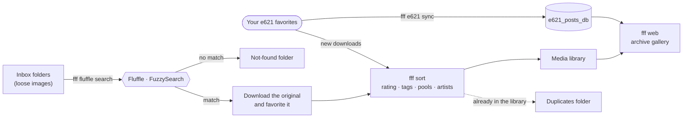

<div align="center">

# FurryFileFinagler

**Your e621 favorites, archived on your own disk · Sources for loose images · A library that sorts itself**

[](https://github.com/IcyRooPaws/FurryFileFinagler/actions/workflows/ci.yml)


Version 1.32.0 · [Changelog](CHANGELOG.md) · [Commands](docs/COMMANDS.md) · [Usage guide](docs/USAGE.md)

</div>

**Contents:** [Highlights](#highlights) · [Quick start](#quick-start) · [Features](#features) ·
[Nightly run](#nightly-run) · [Privacy and security](#privacy-and-security) ·
[Troubleshooting](#troubleshooting) · [Development](#development)

## Highlights

- 🗄️ **e621 favorites kept locally**, with tags, pools and sources, in MySQL.
- 🖼️ **An e621-style gallery** in your browser, with search, trending tags and trends over time.
- 🔍 **Finds sources** for loose images and downloads the originals.
- 🗂️ **Sorts your library** by rating, tags and artists, and catches duplicates.
- 🌙 **Runs nightly** in one command: `fff daily`.
- 🪟 **One window** for everything: the FFF Manager.
- 🛡️ **Safe by default:** test environment, dry runs, holding folders, and nightly backups.



## Quick start

1. Install what you need:
   - Windows 10/11
   - Python 3.11+
   - a MySQL server
   - an [e621 API key](https://e621.net/users/home)
2. Run **`setup.bat`**. It installs FFF and opens the guided setup.
3. Start FFF with **`manager.bat`**.

> [!NOTE]
> FFF won't run any command until the guided setup is finished. You can stop and resume it at any point.

<details>
<summary>Optional extras</summary>

- **FuzzySearch API key:** a second reverse-image search.
- **Firefox-based browser signed in to FurAffinity:** the FurAffinity features.
- **`ffprobe` ([FFmpeg](https://ffmpeg.org/)) on your `PATH`:** video quality in the Duplicates tool.
- **Python 3.10 works too**, but is stuck on an older Pillow with known security issues.

</details>

<details>
<summary>Install by hand (PowerShell)</summary>

```powershell
python -m venv .venv
.venv\Scripts\python -m pip install -r requirements.txt
.venv\Scripts\python -m pip install -e . --no-deps
.venv\Scripts\Activate.ps1  # puts 'fff' on your PATH
fff setup                   # guided setup
fff doctor                  # check everything
```

On macOS or Linux, use `.venv/bin/…` and `source .venv/bin/activate`.

</details>

## Features

| Area | What you get | Start it |
|---|---|---|
| **Archive gallery** | e621-style search, filters, post pages, trending tags, monthly trends | `fff web` → <http://127.0.0.1:5000> |
| **e621 archive** | Sync favorites and files, repair metadata, AI-post cleanup | `fff e621 …` |
| **Source search** | Fluffle and FuzzySearch, download from e621 or FurAffinity | `fff fluffle …` |
| **Media library** | Sort by rules, duplicate detection (including re-encoded videos), archiving | `fff sort …` |
| **Tag tools** | Mark generic and fetish tags, review the blacklist | Manager → Tools |
| **Manager** | Every workflow and tool in one window, prod/test switch | `manager.bat` |
| **Databases** | Create, check, back up, restore | `fff db …`, `fff doctor` |

**Gallery search** works like e621's:

| You type | Finds |
|---|---|
| `wolf solo` | both tags |
| `wolf -comic` | without a tag |
| `~fox ~wolf` | either tag |
| `wolf*` | names starting with "wolf" |

## Nightly run

`fff daily` runs: **backup → source search → sort → e621 sync → AI cleanup → sort → FurAffinity
sync**. A failed stage doesn't stop the rest, and each run writes a summary to `logs/daily/`.

To schedule it, add a Windows Task Scheduler task:

```text
Program:    powershell
Arguments:  -NoProfile -ExecutionPolicy Bypass -File "D:\path\to\fff_daily.ps1" -scheduled
```

> [!IMPORTANT]
> FurAffinity stages are skipped until you agree to cookie use once: `fff consent browser-cookies`.

> [!CAUTION]
> The test environment (`fff --env test`) copies your databases and folders, but e621 and
> FurAffinity are still your real accounts.

## Privacy and security

Everything stays on your computer, except what these services receive:

| Service | Receives |
|---|---|
| e621 | Your API key, favorites and votes |
| Fluffle, FuzzySearch | The image being searched |
| FurAffinity | Your FA cookies (only after you agree) |

- `config/secrets.yaml` holds your credentials, is never committed, and only your account can read it.
- The gallery only answers to this computer.
- Files are moved to holding folders or the recycle bin, never deleted.
  [What each command changes →](docs/USAGE.md#what-can-change-things-outside-this-folder)

> [!WARNING]
> `fff web --host 0.0.0.0` shares your whole archive with your network, with no login.

## Troubleshooting

Run **`fff doctor`** first. It checks everything and lists what's wrong.

| Problem | Fix |
|---|---|
| "FFF isn't set up yet" | Finish setup: `manager.bat` or `fff setup` |
| Gallery says "Unknown host" | Use <http://127.0.0.1:5000>, or `fff web --allow-host NAME` |
| No **Open file** button | Only shown on the computer running `fff web` |
| FurAffinity stages skipped | `fff consent browser-cookies` |
| Nightly run failed | See `logs/daily/` |
| Something went wrong | `fff db restore` brings back a nightly backup |

## Development

<details>
<summary>Tests, lint and config files</summary>

```powershell
.venv\Scripts\python -m pytest                        # tests
$env:FFF_INTEGRATION=1; .venv\Scripts\python -m pytest -m integration  # test databases
python tools/gui_smoke.py manager                      # Manager smoke test
.venv\Scripts\python -m ruff check fff tests tools     # lint
.venv\Scripts\python -m pip_audit -r requirements.txt  # vulnerabilities (pip install pip-audit)
```

- **Config:** real files in `config/` are gitignored. Each has a committed `*.example.*` copy.
- **Versions:** each change bumps `fff/__init__.py` and adds a [CHANGELOG](CHANGELOG.md) entry.
- **CI** runs lint, tests and a dependency audit on every push.

</details>
